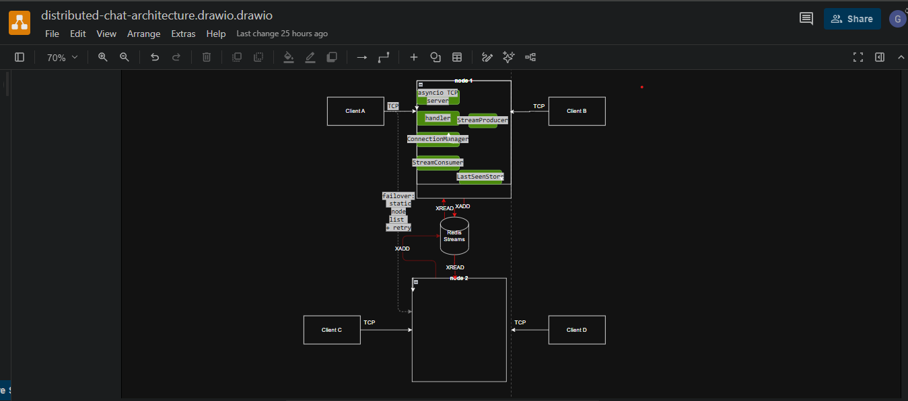
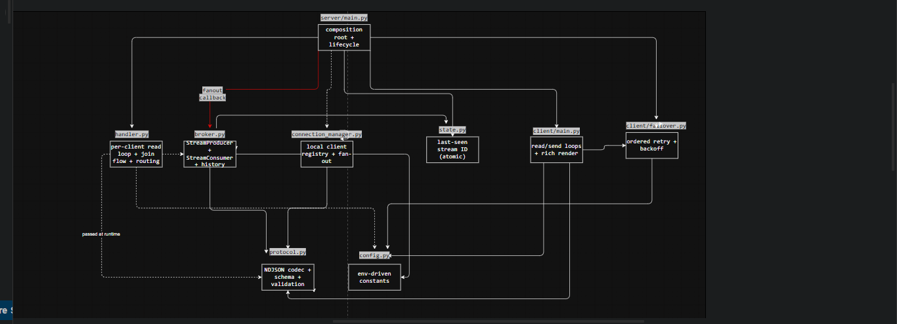
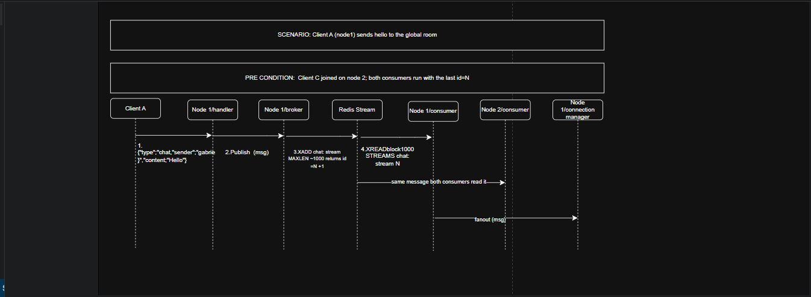

# Distributed Chat Application

A simple **distributed real-time chat** built with Python **asyncio TCP sockets** and
**Redis Streams**. Multiple clients connect to one of two server nodes; messages are
relayed between nodes through a shared Redis Stream, so a client on node1 sees
messages from a client on node2 in real time.

The project demonstrates core distributed-systems concepts in a small, readable
codebase: cross-node message ordering, restart-resume from a persisted cursor,
and client-driven failover.

---

## Table of Contents

- [Features](#features)
- [Architecture Overview](#architecture-overview)
- [Requirements](#requirements)
- [Installation](#installation)
  - [1. Clone the repository](#1-clone-the-repository)
  - [2. Create a virtual environment](#2-create-a-virtual-environment)
  - [3. Install dependencies](#3-install-dependencies)
  - [4. Start Redis](#4-start-redis)
- [Usage](#usage)
  - [Running the server nodes](#running-the-server-nodes)
  - [Running the client](#running-the-client)
  - [Using the chat](#using-the-chat)
- [Configuration](#configuration)
- [Project Structure](#project-structure)
- [Known Limitations](#known-limitations)


---

## Features

- **Real-time messaging** across multiple clients and multiple server nodes.
- **Two server nodes** running independently, synchronized via a single Redis Stream.
- **Persistent message history** — a joining client receives the last 50 chat messages.
- **Globally unique usernames** enforced with Redis `SET NX` (case-insensitive).
- **Client-side failover** — if the connected node goes down, restarting the client
  transparently connects to a live node from a static list.
- **Cursor-based restart resume** — a node that restarts picks up where it left off
  without replaying or missing messages.
- **Structured NDJSON wire protocol** with schema validation and versioning.

---

## Architecture Overview

The topology of the application


The interactions of the components together


life cycle of the message


- **Clients** speak NDJSON over TCP. First frame is `join`, then `chat` or `leave`.
- **Nodes** accept connections, validate messages, and publish every frame to the
  Redis Stream.
- **Every node's consumer** reads the stream and fans out to its own local clients.
  Nodes never share client state.
- **Redis Streams** is the single source of truth for ordering and persistence.


---

## Requirements

- **Python 3.11+** (developed on 3.14)
- **Redis 7+**
  - Recommended: run via **Docker**
  - Or install locally (`apt install redis-server`, `brew install redis`, etc.)
- **Git**
- Windows 10/11, macOS, or Linux

---

## Installation

### 1. Clone the repository

```bash
git clone Gabriel-affont/Distributed-chat-application
cd distributed-chat

2. create a virtual evnviroment
On comand prompt
.venv\Scripts\activate.bat

3.Install dependencies with the virtual evnviroment activated
python -m pip install --upgrade pip
python -m pip install -r requirements.txt

4.Start Redis use docker
docker compose up -d
verify:
docker exec -it distributed-chat-application-redis-1 redis-cli ping

Usage 
The application needs two nodes running simultaneously, sharing one Redis.
Terminal 1 — start node1 (default port 9001):
python -m server.main

Terminal 2 — start node2 (port 9002):
# Windows (PowerShell):
$env:CHAT_NODE_ID="node2"; $env:CHAT_PORT="9002"
python -m server.main

Running the client
open a new terminal per client
Terminal 3 Alice
python -m client.main alice

Terminal 4 — client "bob":
python -m client.main bob

One-command demo
Helper scripts start both nodes and print the exact client commands for your
shell: .\scripts\demo_two_nodes.ps1

Using the chat
Once a client is running:

Send a message — type any text and press Enter. All connected clients
(on both nodes) receive it immediately.

See history on join — when you connect, the client displays up to the last
50 chat messages, followed by live messages.

Leave — type quit or press Ctrl-D to send a leave event and exit.

Reconnect after failover — if the node you were connected to goes down,
the client exits. Restart the client and it will automatically connect to the
next live node in its list.

Known Limitations
These are deliberate scope trade-offs, documented for transparency.

Static node discovery — the client's node list is fixed in config.py.
Adding a node requires a config edit and restart.

Single consumer per node — one XREAD task per node is the throughput
ceiling. Consumer groups are the future-work upgrade path.

Username TTL on hard crash — a client killed without a clean disconnect
keeps its username reserved until CHAT_USERNAME_TTL (default 1 hour).

History excludes join/leave events — the history frame is chat-only;
joining clients see prior conversations, not a roster of joins/leaves.

No mid-session reconnect — if the connected node dies, the client exits;
restarting it fails over to a live node. Automatic reconnection is planned
future work.

No authentication — the server overwrites the sender with the username
from join, preventing casual spoofing but not real auth.

PROJECT STRUCTURE
distributed-chat/
│
├── README.md                       
├── requirements.txt                 
├── pyproject.toml                  
├── .gitignore                       
├── .env.example                     
├── docker-compose.yml               
│
├── config.py                        
│                                    
├── protocol.py                      
│
├── server/
│   ├── __init__.py
│   ├── main.py                      
│   │                                
│   ├── handler.py                   
│   │                                
│   ├── connection_manager.py        
│   │                                
│   ├── broker.py                    
│   │                                
│   └── state.py                     
│                                   
│
├── client/
│   ├── __init__.py
│   ├── main.py                     
│   │                                
│   └── failover.py                  
│                                   
│
├── tests/
│   ├── __init__.py
│   ├── conftest.py                 
│   │                                
│   ├── test_protocol.py            
│   │                                
│   ├── test_state.py                
│   ├── test_broker.py               
│   │                               
│   ├── test_connection_manager.py  
│   ├── test_handler.py              


